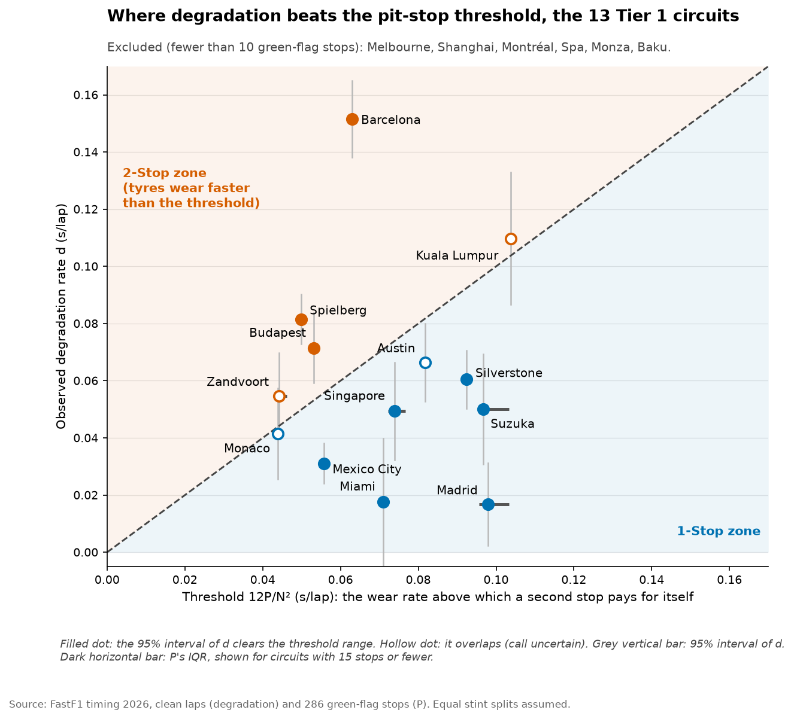

# Decision layer: one stop or two?

Reproduce: `python -m f1_pit_strategy.decision` (this file is generated). Needs `degradation_by_circuit.csv` (step 7) and `pit_loss.csv` (step 6).

**Rule.** Two stops beat one when the degradation rate d is above the threshold 12P/N² (P = pit-lane loss in seconds, N = race laps, equal stint splits).
d is the circuit's lap-weighted mean of its compound wear slopes, from one regression per circuit (driver intercepts, shared race-lap term, a tyre-age slope per compound; standard errors clustered by stint).

## Result

At the 13 Tier 1 circuits the rule gives **5 two-stop and 8 one-stop calls**; 4 of the 13 calls are uncertain because the 95% interval of d overlaps the threshold range (P's IQR).

| Circuit | Clean Laps | Degradation Rate (s/lap) | Valid Pit Stops (n) | Median P (s) | Threshold (12P/N²) | Recommended Strategy | Certainty of call |
|---|---|---|---|---|---|---|---|
| Barcelona | 966 | 0.152 (0.138 to 0.165) | 40 | 22.9 | 0.063 | 2-Stop | clear |
| Spielberg | 1,118 | 0.081 (0.073 to 0.090) | 33 | 20.9 | 0.050 | 2-Stop | clear |
| Budapest | 1,175 | 0.071 (0.059 to 0.084) | 33 | 21.7 | 0.053 | 2-Stop | clear |
| Zandvoort | 485 | 0.055 (0.040 to 0.070) | 13 | 19.1 (IQR 18.6-20.0) | 0.044 | 2-Stop | uncertain |
| Kuala Lumpur | 385 | 0.110 (0.087 to 0.133) | 24 | 26.2 | 0.104 | 2-Stop | uncertain |
| Monaco | 1,119 | 0.041 (0.026 to 0.057) | 18 | 22.2 | 0.044 | 1-Stop | uncertain |
| Austin | 844 | 0.066 (0.053 to 0.080) | 26 | 21.4 | 0.082 | 1-Stop | uncertain |
| Singapore | 951 | 0.049 (0.032 to 0.066) | 15 | 23.7 (IQR 23.1-24.6) | 0.074 | 1-Stop | clear |
| Mexico City | 682 | 0.031 (0.024 to 0.038) | 20 | 23.4 | 0.056 | 1-Stop | clear |
| Silverstone | 758 | 0.060 (0.050 to 0.071) | 19 | 20.8 | 0.092 | 1-Stop | clear |
| Suzuka | 891 | 0.050 (0.031 to 0.069) | 12 | 22.6 (IQR 22.3-24.2) | 0.097 | 1-Stop | clear |
| Miami | 712 | 0.018 (-0.004 to 0.040) | 19 | 19.2 | 0.071 | 1-Stop | clear |
| Madrid | 915 | 0.017 (0.002 to 0.031) | 14 | 26.5 (IQR 25.9-28.0) | 0.098 | 1-Stop | clear |
| Shanghai | 639 | 0.052 (0.040 to 0.064) | 4 | N/A (Insufficient green-flag stops: n < 10) | N/A (Insufficient green-flag stops: n < 10) | N/A (Insufficient green-flag stops: n < 10) |  |
| Spa | 597 | 0.051 (0.034 to 0.067) | 9 | N/A (Insufficient green-flag stops: n < 10) | N/A (Insufficient green-flag stops: n < 10) | N/A (Insufficient green-flag stops: n < 10) |  |
| Melbourne | 774 | 0.029 (0.018 to 0.040) | 8 | N/A (Insufficient green-flag stops: n < 10) | N/A (Insufficient green-flag stops: n < 10) | N/A (Insufficient green-flag stops: n < 10) |  |
| Monza | 833 | 0.015 (0.004 to 0.026) | 2 | N/A (Insufficient green-flag stops: n < 10) | N/A (Insufficient green-flag stops: n < 10) | N/A (Insufficient green-flag stops: n < 10) |  |
| Baku | 648 | 0.010 (0.002 to 0.019) | 2 | N/A (Insufficient green-flag stops: n < 10) | N/A (Insufficient green-flag stops: n < 10) | N/A (Insufficient green-flag stops: n < 10) |  |
| Montréal | 714 | 0.000 (-0.009 to 0.009) | 6 | N/A (Insufficient green-flag stops: n < 10) | N/A (Insufficient green-flag stops: n < 10) | N/A (Insufficient green-flag stops: n < 10) |  |

`Certainty of call` is *clear* when the whole 95% interval of d lies above (or below) the threshold range built from P's IQR, and *uncertain* when it overlaps. Order: Tier 1 by margin (d minus threshold), then Tier 2.

## Why a scatter plot with error bars and a y = x line

- **The decision is a comparison of two numbers in the same unit.** d (observed wear) and the threshold 12P/N² are both seconds per lap. Putting the threshold on x and d on y, with a
  dashed y = x line, turns the rule into geometry: above the line two stops, below one stop, and the distance from the line is the margin. Paired bars for 13 circuits would make the reader subtract
  by eye; a bar of the margin alone would hide whether a circuit is far from the line because wear is high or because the threshold (pit loss, race length) is low.
- **The line is the rule itself.** Both axes use the same limits (0 to 0.17), so the 45 degree line is an honest boundary, not a drawing choice.
- **Error bars show what the point estimate hides.** The vertical bar is the 95% interval of d; the horizontal bar is P's IQR for the circuits where P rests on few stops. Uncertainty in d and in the
  threshold sit on different axes, so a 2D plot shows both at once. A filled dot means the interval clears the threshold range, a hollow dot means the call could flip.
- **Readable and accessible.** Direct labels (no legend lookup), colour-blind-safe colours, and the excluded Tier 2 circuits named in the subtitle.
- **Limits.** Thirteen labelled points are close to crowding; the chart shows Tier 1 only, so the table above carries the exact numbers and Tier 2. The intervals are statistical: they do not weigh the cost
  of a wrong call.

## Methodological notes

**Why six circuits have no call (Tier 2).** Monza (n = 2), Baku (n = 2), Shanghai (n = 4), Montréal (n = 6), Melbourne (n = 8), Spa (n = 9) have fewer than 10 usable green-flag, dry stops. Safety cars, yellow flags and rain removed most of their green-flag stops (833 stops found, 317 usable overall), and a median P from so few stops is too noisy to decide a strategy. We do not impute P or borrow it from other circuits; their degradation rate and lap count are still shown because those rest on hundreds of laps.

**Borderline Tier 1 circuits.** Suzuka (n = 12, P 22.6 s, IQR 22.3 to 24.2), Zandvoort (n = 13, P 19.1 s, IQR 18.6 to 20.0), Madrid (n = 14, P 26.5 s, IQR 25.9 to 28.0), Singapore (n = 15, P 23.7 s, IQR 23.1 to 24.6) sit just above the cutoff; their P's spread is shown in the table and as dark horizontal bars on the chart.

**Robustness.** Replacing driver intercepts by team intercepts changes d by at most 0.014 s/lap (correlation 0.99 across the 19 circuits) and flips 0 of the 13 Tier 1 calls.

## Limits

- The 12P/N² rule assumes equal stint splits and one linear wear rate per race; real strategies mix compounds and stint lengths (the grid-search optimiser, a later step, relaxes that).
- d is a mean of compound slopes weighted by laps run, so it describes the mix teams actually ran. Wear beyond about 30 laps of tyre age is thinly observed (docs/eda.md, chart 5), and a one-stop needs long stints.
- A stint's slope shows wear plus the race-lap effect together; the model splits them using stints that start on different laps. A wrong race-lap effect would shift every compound of a circuit by the same amount.
- Mexico City data stops at lap 56 of 71 (N = 71 is used). Traffic is not filtered. P is the median of the stop-lap loss and carries the approximations listed in docs/scope.md.
- Intervals use stint-clustered standard errors with 30 to 65 stints per circuit; they are approximate.
