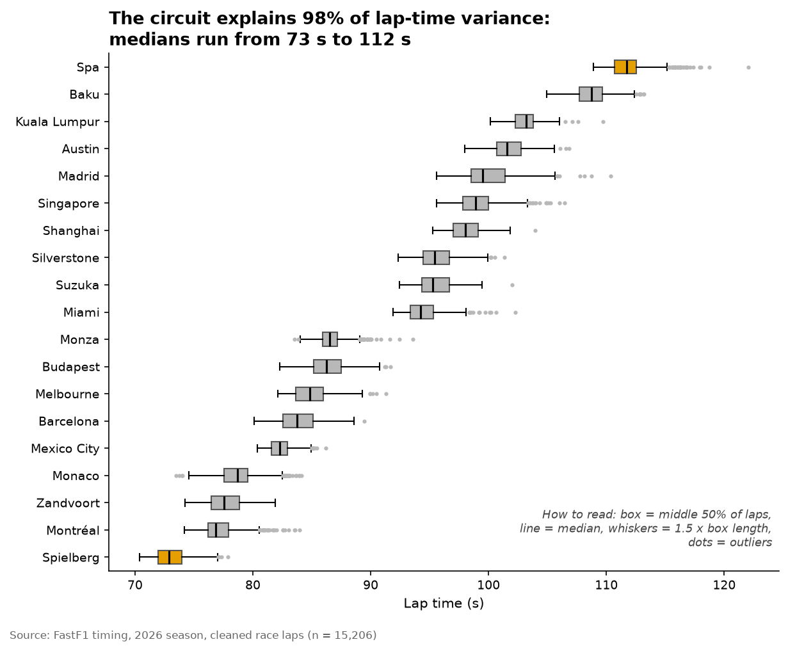
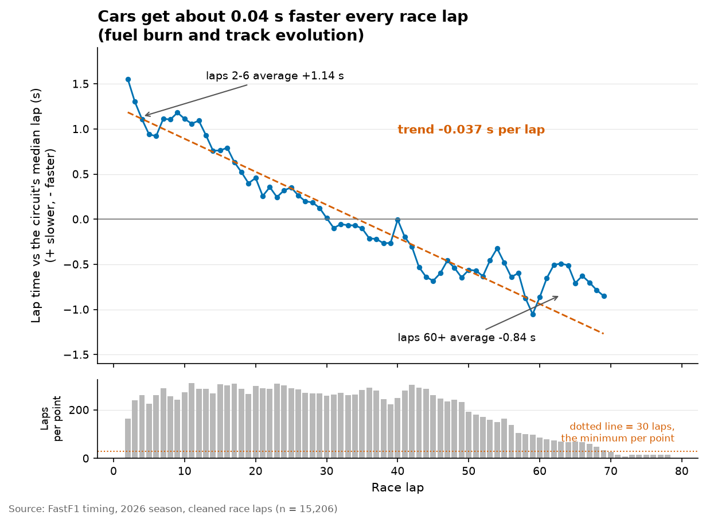
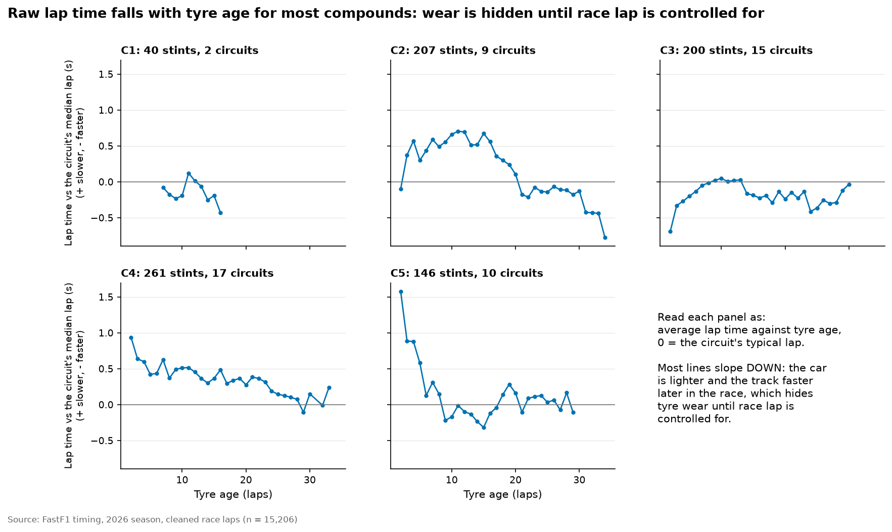
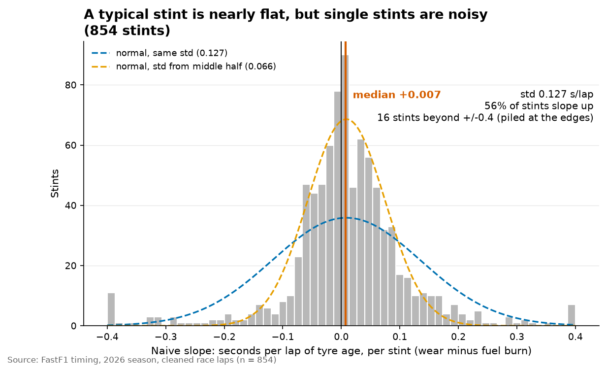
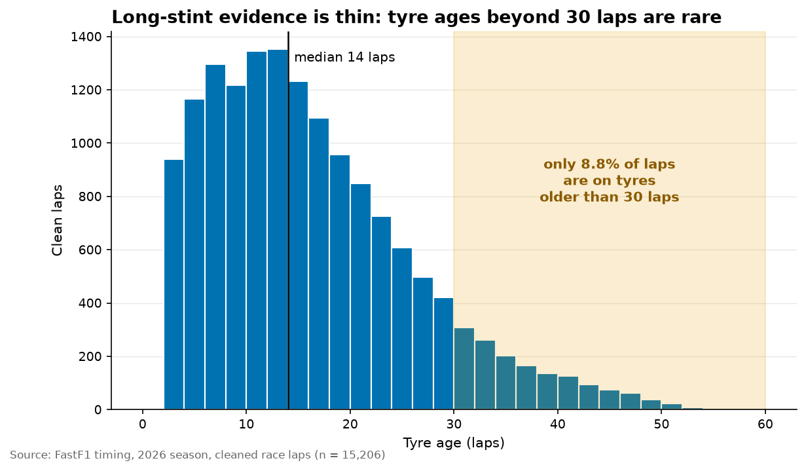
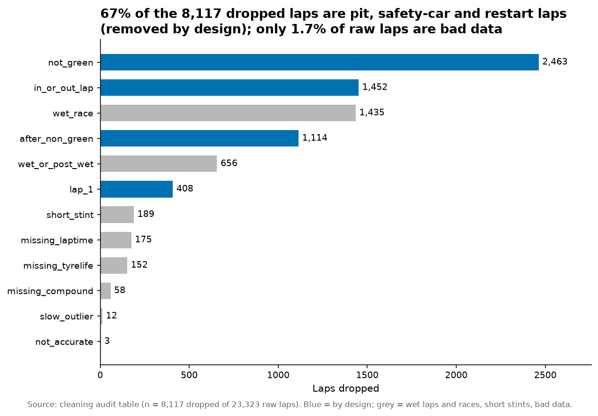
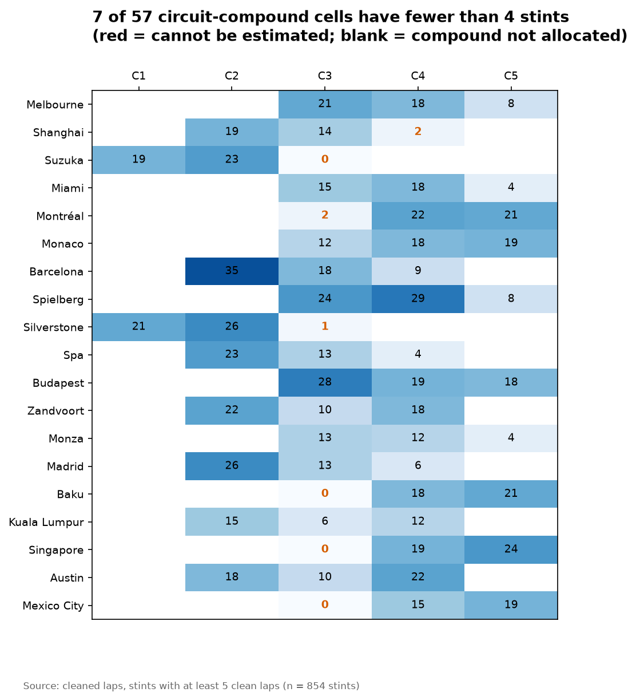
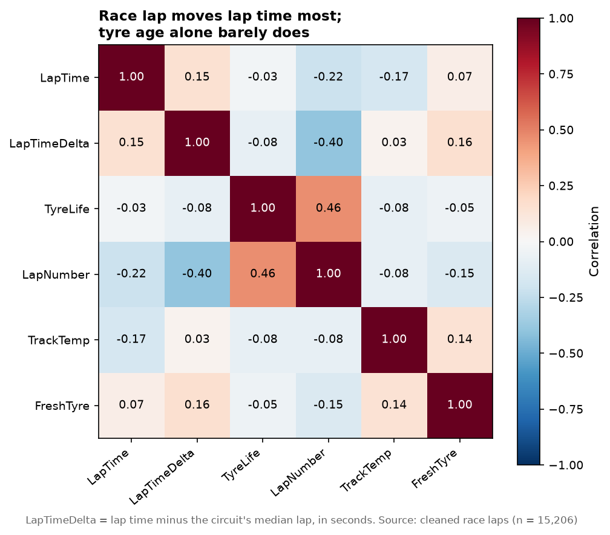

# Exploratory analysis of the clean laps

Source: `data/processed/clean_laps.parquet` (15,206 laps, 854 stints, 19 circuits).
Reproduce: `python -m f1_pit_strategy.eda` (this file is generated; charts go to `reports/figures/`, reports to `reports/analysis/`).
Method: the EDA and data-quality workflows of the data-analytics-skills repository (https://github.com/nimrodfisher/data-analytics-skills), see the README.

Circuits are labelled by host city or town (`city` column of `data/reference/pirelli_allocation.csv`).

**The variable `LapTimeDelta`.** Lap times cannot be compared between circuits (Spa about 112 s, Spielberg about 73 s). So each lap is also
expressed as `LapTimeDelta` = its lap time minus the median clean lap time of its own circuit, in seconds. **0 is a typical lap at that circuit,
+1 is one second slower, -1 is one second faster.** Example: at Spa (median 111.7 s) a 112.7 s lap has `LapTimeDelta` = +1.0.
Why it exists: **97.9% of the variance in raw lap time is between circuits**, so raw comparisons mostly measure "which track".

Each chart below has a business conclusion (what it means for the stop-count decision) and a statistical conclusion (what it means for the model).

---

## 1. Circuit explains lap time (`01_circuit_dominates_lap_time.png`)

**Why this chart.** Comparing 19 distributions at once is a box-plot job: it shows the median, the middle 50% of laps, and the outliers per circuit.

|  | mean | median | p5 | p95 | p99 | max |
|---|---|---|---|---|---|---|
| Lap time (s) | 90.42 | 88.31 | 73.61 | 109.49 | 112.54 | 122.04 |
| LapTimeDelta (s) | 0.15 | 0.00 | -2.19 | 3.00 | 4.39 | 10.88 |
| Tyre age (laps) | 15.78 | 14.00 | 3.00 | 35.00 | 45.00 | 57.00 |

**Where the table comes from.** It is `describe()` run on the 15,206 clean laps in `data/processed/clean_laps.parquet`, all circuits pooled: row 1 is `LapTime` in seconds, row 2 is `LapTimeDelta` (defined above), row 3 is `TyreLife`. `p5` is the value 5% of laps fall below. Pooling is why the lap-time row is so wide: it mixes tracks. Only the other two rows are comparable across circuits.

- Circuit medians run from 72.9 s to 111.7 s. Inside a circuit the middle 90% of laps (p5 to p95) spans only 2.9 s to 6.8 s.

**Outliers.** Inside each circuit (box-plot rule: beyond 1.5 times the box length), 200 laps are outliers and 97% of the flagged laps are slow ones. The top four are Monza 35, Monaco 32, Spa 32, Montréal 26; Miami has 11 (rank 6).

| City | Outliers | Share of laps | Box length (s) | In 3 stints |
|---|---|---|---|---|
| Monza | 35 | 4.2% | 1.27 | 71% |
| Monaco | 32 | 2.9% | 2.01 | 34% |
| Spa | 32 | 5.4% | 1.82 | 81% |
| Montréal | 26 | 3.6% | 1.75 | 62% |
| Singapore | 14 | 1.5% | 2.2 | 93% |
| Miami | 11 | 1.5% | 1.94 | 100% |

Why those circuits:
- **The rule is relative to each circuit's own spread.** The narrower the box (Monza 1.27 s), the sooner an ordinary slow lap is flagged.
- **They are concentrated, not scattered.** The last column shows the share of flagged laps that sit in just three stints: whole stints are slow, which points to a car or a pace choice, not to single mistakes.
- **Two teams make most of them.** Cadillac and Aston Martin are 14% of the clean laps but 81% of the slow outliers, running +2.3 s and +2.0 s slower than the circuit median on average. These are slow cars, not bad data, so they stay in. Traffic is also not filtered in v1 and may add to it (not tested).

**Heteroscedasticity (unequal spread).** The spread of `LapTimeDelta` is not the same everywhere:
- Between circuits: the standard deviation runs from 0.94 s (Mexico City) to 2.14 s (Madrid), a 5.2x difference in variance (Brown-Forsythe test, p < 0.0001).
- Along the race: from 1.36 s to 1.58 s across race-lap bands, highest after lap 40 (p < 0.0001).
- By tyre age: 1.73 s at ages 2-5 falling to 1.38 s at ages 21-30.
- By team: team explains 48% of the variance of `LapTimeDelta`. After the circuit is removed, car pace is the biggest thing left.

**Why `LapTimeDelta` and not raw `LapTime`.**
- Raw lap time has 46x the variance of the delta (117 against 2.5 s squared), almost all of it "which circuit".
- Its distribution is a mixture, not one bell: the circuit medians form three groups (9 circuits at 73-87 s; 8 circuits at 94-103 s; 2 circuits at 109-112 s), and its excess kurtosis is -0.95 (flat) against +0.78 for the delta, whose slow-side tail gives skew +0.58.
- Raw correlations measure the circuit: `TrackTemp` is -0.17 with raw lap time and +0.03 with the delta (chart 8).
- Limits of the delta: its zero is the median of the clean laps that survived cleaning, so it depends on which laps survived (Mexico City's median uses laps 1-56 only; Zandvoort lost its rain laps). Subtracting a circuit level removes neither the unequal spread nor the team differences above.

**Business conclusion.** A lap time means nothing without its circuit, and a slow car's lap means little next to a fast car's. Every comparison is made inside a circuit, and degradation is read as a change within a stint, not as a level.
**Statistical conclusion.** The circuit explains 97.9% of the variance, so the model works inside circuits. What is left is unequal: the spread differs by circuit, by race lap and by tyre age, and team explains 48% of it. The model needs team or stint intercepts (or within-stint slopes, which cancel a constant car-pace offset) and should weight stints by precision.

---

## 2. Cars get faster through a race (`02_lap_time_falls_with_race_lap.png`)

**Why this chart.** It tests the biggest confounder directly: how lap time moves with race lap (fuel burn and track evolution together). One line of averages plus a fitted trend.

- Laps 2 to 6 average **+1.14 s**; laps 60 and later average **-0.84 s**. A straight line through all laps gives **-0.0366 s per race lap**.

**Why is the line more volatile after lap 40?** Two reasons:
1. **Fewer laps behind each point.** 271 laps per point up to lap 40, 155 after it (bars under the chart). The standard error of a point grows from 0.09 s to 0.15 s, and the points scatter around the trend by 0.15 s before lap 40 and 0.27 s after.
2. **A changing mix of circuits.** Races last 44 to 78 laps, so circuits drop out as the race goes on: 18 circuits contribute at lap 41, 11 at lap 55, 6 at lap 60 and 3 at lap 69. Each exit shifts the average; for example Melbourne's race ends at lap 58.

Read the line with care after about lap 55. The dashed trend is fitted on all laps and is not affected by this.

**Business conclusion.** The car speeds up by about 0.04 s every lap, a large effect against the stop-count threshold (its size per circuit is in the insight brief). Reading tyre wear straight off raw lap times would make tyres look as if they do not wear.
**Statistical conclusion.** Race lap and tyre age are confounded: wear pushes lap time up while fuel burn and track evolution push it down. The model must include race lap (`LapNumber`). It can separate the two because drivers start stints on different race laps. Only their combined effect is estimated; race data cannot split fuel from track. Late-race points are about 1.7 times less precise than early ones, so laps should not all count equally. The variance inflation factors are at most 1.30, so the two are not collinear enough to stop that.

---

## 3. Raw tyre-age curves are not degradation (`03_tyre_age_by_compound.png`)

**Why this chart.** It is the direct visual test of H1 (do softer compounds slow down faster with age?). Five compounds need five panels (at most four lines per chart is readable), with a shared axis so panels compare.

Average `LapTimeDelta` (s) by tyre-age band:

| CompoundAbsolute | 2-5 | 6-10 | 11-20 | 21-30 | 31+ |
|---|---|---|---|---|---|
| C1 | -0.43 | -0.14 | -0.37 | -0.66 | -1.03 |
| C2 | 0.33 | 0.55 | 0.49 | -0.14 | -0.67 |
| C3 | -0.35 | -0.03 | -0.12 | -0.23 | 0.05 |
| C4 | 0.63 | 0.49 | 0.38 | 0.21 | 0.38 |
| C5 | 0.89 | 0.05 | -0.06 | 0.03 | 0.41 |

What each curve looks like (only tyre ages with at least 30 laps are drawn):

| Compound | Circuits | Ages shown | Curve range (s) | Mean step (s) | Slope of curve (s/lap) | Main suppliers | Role |
|---|---|---|---|---|---|---|---|
| C1 | 2 | 7-16 | -0.43 to +0.12 | 0.13 | -0.019 | Suzuka 58%, Silverstone 42% | hard at 2 |
| C2 | 9 | 2-34 | -0.77 to +0.71 | 0.12 | -0.033 | Madrid 18%, Barcelona 16%, Shanghai 13% | hard at 7, medium at 2 |
| C3 | 15 | 2-30 | -0.69 to +0.05 | 0.09 | -0.001 | Budapest 15%, Spielberg 14%, Melbourne 13% | hard at 10, medium at 7, soft at 2 |
| C4 | 17 | 2-33 | -0.11 to +0.93 | 0.1 | -0.020 | Monaco 13%, Spielberg 11%, Montréal 9% | medium at 10, soft at 7 |
| C5 | 10 | 2-29 | -0.32 to +1.58 | 0.17 | -0.025 | Singapore 23%, Mexico City 17%, Baku 13% | soft at 10 |

**Business conclusion.** Most curves slope down: older tyres look faster because they run later in the race on lighter cars. Ignoring fuel load, tyres would look as if they do not degrade, and the stop-count call would be wrong.
**Statistical conclusion.**
- **Behaviour of the curves.** They do not share one shape. C3 starts low and climbs towards zero over its first ages; C4 and C5 start high and fall; C2 rises, then falls after the middle of its range. The straight-line slope of every curve is at or below zero (column *Slope of curve*), so none shows wear on its own, and the softest compound (C5) is not steeper upwards than the hardest (C1), the opposite of what H1 expects.
- **Volatility.** Curves jump 0.09 to 0.17 s between neighbouring ages: C3 is smoothest (it has the most circuits, 15) and C5 is the most erratic. Volatility grows with age because bins need at least 30 laps and the older bins hold barely that many; C1 only has ages 7 to 16.
- **Similarity.** Correlation between two curves over their shared ages runs from -0.64 (C3 vs C5) to +0.63 (C1 vs C3): there is no common compound-wear shape.
- **Why they differ.** Each compound is run by different circuits (column *Main suppliers*) and plays different roles (column *Role*: the same C-number is the hard at some circuits and the soft at others). A curve therefore mixes circuit, race stage and compound, and the five curves cannot be compared with each other. Separating them needs the circuit x compound model (H2), with race lap controlled.
These curves are not estimates of β.

---

## 4. Single stints are noisy (`04_stint_slopes_are_noisy.png`)

**Why this chart.** It previews stage 1 of the model (one slope per stint): the size, sign and spread of those slopes before anything is built on them. "Naive" means no fuel correction, so each slope is tyre wear minus fuel and track speed-up.

| n | mean | median | std | p5 | p25 | p75 | p95 | min | max |
|---|---|---|---|---|---|---|---|---|---|
| 854 | +0.009 | +0.007 | 0.127 | -0.143 | -0.034 | +0.056 | +0.170 | -1.02 | +0.76 |

16 stints lie beyond +/-0.4 (piled at the plot edges), 70 are Tukey outliers, and 56% slope upward. Median per compound:

| CompoundAbsolute | Stints | Median | Positive |
|---|---|---|---|
| C1 | 40 | -0.008 | 37.5% |
| C2 | 207 | -0.001 | 48.8% |
| C3 | 200 | 0.029 | 72.5% |
| C4 | 261 | 0.009 | 59.0% |
| C5 | 146 | -0.007 | 43.2% |

**Business conclusion.** Once the speed-up is netted out, a typical stint is close to flat. If the speed-up is about 0.037 s per lap everywhere, a median naive slope of +0.007 would imply β of about 0.04 s per lap, to be compared with a threshold of 0.081 s per lap for a 57-lap race with a 22 s pit loss. This is a rough pointer only, not a result; the real β comes from the model.
**Statistical conclusion.** The slopes are not normally distributed, and the chart shows it (the dashed curves are normal densities):
- **Sharper peak, heavier tails.** Excess kurtosis is 16.8 (a normal is 0) and skew is -1.37; the Jarque-Bera normality test gives p < 0.0001. The standard deviation (0.127) is 1.9 times what the middle half of the data implies (0.066), and 2.2% of stints lie beyond 3 standard deviations against 0.3% for a normal.
- **The cause is stint length (heteroscedasticity).** A short stint gives a noisy slope and a long stint a precise one, so one pile of stints mixes very different spreads, which produces exactly a sharp peak with long tails:

| Laps in stint | Stints | Std | Box | Kurtosis |
|---|---|---|---|---|
| 5-9 | 183 | 0.233 | 0.185 | 4.3 |
| 10-14 | 163 | 0.109 | 0.116 | 2.8 |
| 15-19 | 175 | 0.062 | 0.072 | 0.9 |
| 20-29 | 254 | 0.047 | 0.062 | 1.1 |
| 30+ | 79 | 0.039 | 0.047 | 0.8 |

  The spread falls 6-fold from the shortest to the longest stints, and the tails become nearly normal (kurtosis around 1) from 15 laps up.
- **Not only noise.** Dividing each slope by its own standard error should give a spread near 1; it gives 3.9. Stints really differ (traffic, pace management, car pace). Separately, 48% of stints are statistically indistinguishable from flat.
- **Consequence for the model.** Do not put normal-theory intervals on raw slopes. Stage 2 should weight each stint by its precision plus a between-stint variance, or use a robust fit (median or Huber) or t-distributed errors. H1 cannot be read from these naive slopes.

---

## 5. Long-stint evidence is thin (`05_tyre_age_coverage.png`)

**Why this chart.** A histogram shows where tyre-age data exists and where it does not.

- Tyre age: median 14 laps, p95 35, p99 45, maximum 57. 8.8% of laps are on tyres older than 30 laps.
- In race laps, 179 of 854 stints (21%) run 28 or more laps. (Tyre age counts laps on used sets from before the stint, so it overstates stint length.)

**Business conclusion.** A one-stop in a 55 to 70 lap race needs stints of about 28 laps or more, which is exactly where data is scarce, so one-stop verdicts are judged on the least evidence.
**Statistical conclusion.** Beyond about 30 laps of tyre age the fitted slope is an extrapolation with wide uncertainty; verdicts that depend on it should say so.

---

## 6. Most dropped laps are dropped by design (`06_cleaning_funnel.png`)

**Why this chart.** Thirteen reasons fit horizontal bars sorted by size (the 8 to 15 category rule); blue marks the four by-design rules.

- 8,117 of 23,323 raw laps are dropped (34.8%). 67% of the dropped laps are lap 1, pit, safety-car or restart laps. Bad data (missing values, inaccurate, outliers) is 1.7% of raw laps.

**Business conclusion.** The cleaning loss is not a data-quality problem: the lost laps are not normal racing, and tyre wear cannot be read from them.
**Statistical conclusion.** Results apply to normal dry green-flag racing laps only (a deliberate selection). Every dropped lap is logged with exactly one reason in `data/processed/exclusions.parquet`, so the selection can be audited.

---

## 7. Coverage per circuit and compound (`07_stints_per_cell.png`)

**Why this chart.** A matrix of counts shows coverage at a glance; thin cells are bold red.

- 45 of 57 circuit-compound cells have 8 or more stints, 5 have 4 to 7, 7 have fewer than 4 (Shanghai C4; Suzuka C3; Montréal C3; Silverstone C3; Baku C3; Singapore C3; Mexico City C3).

**Business conclusion.** The decision rule cannot cover the 7 thin combinations; at every circuit at least two of the three allocated compounds can be estimated.
**Statistical conclusion.** Cells with 4 to 7 stints give wide intervals. The 7 thin cells are reported as not estimable and are never filled in; they are compounds teams barely or never ran, which no cleaning rule can change.

---

## 8. Correlation matrix (`08_correlation_matrix.png`)

**Why this chart.** The standard check for strong pairs and for multicollinearity among the model's features. Both lap-time versions are shown: raw `LapTime` and circuit-adjusted `LapTimeDelta`.

|  | LapTime | LapTimeDelta | TyreLife | LapNumber | TrackTemp | FreshTyre |
|---|---|---|---|---|---|---|
| LapTime | 1.00 | 0.15 | -0.03 | -0.22 | -0.17 | 0.07 |
| LapTimeDelta | 0.15 | 1.00 | -0.08 | -0.40 | 0.03 | 0.16 |
| TyreLife | -0.03 | -0.08 | 1.00 | 0.46 | -0.08 | -0.05 |
| LapNumber | -0.22 | -0.40 | 0.46 | 1.00 | -0.08 | -0.15 |
| TrackTemp | -0.17 | 0.03 | -0.08 | -0.08 | 1.00 | 0.14 |
| FreshTyre | 0.07 | 0.16 | -0.05 | -0.15 | 0.14 | 1.00 |

Variance inflation factors: TyreLife 1.28, LapNumber 1.30, TrackTemp 1.03, FreshTyre 1.04.

**Why `LapTimeDelta` is the column to read.** Raw `LapTime` correlations mostly reflect the circuit: `TrackTemp` correlates -0.17 with raw lap time only because the hot circuits in this season happen to be fast; against `LapTimeDelta` it is +0.03, about zero. The raw column answers "which track", the `LapTimeDelta` column answers "what changes lap time at a given track".

**Business conclusion.** Race lap (fuel and track evolution) is the strongest linear driver of lap time (-0.40); tyre age alone is weak (-0.08). Degradation is a small effect next to the others, which is why the rule needs a careful estimate and not a glance at a chart. Track temperature shows no clear linear link here; H3 needs the circuit and compound controls to be tested properly.
**Statistical conclusion.** The largest correlation between two features is 0.46 (`TyreLife` with `LapNumber`) and every variance inflation factor is at most 1.30, so there is no multicollinearity problem and both can enter one model. The matrix is pooled across circuits and linear, so it cannot show the circuit x compound interaction (H2) or effects inside a stint. `FreshTyre` at +0.16 is confounded with race lap (fresh sets run early on heavy fuel).
