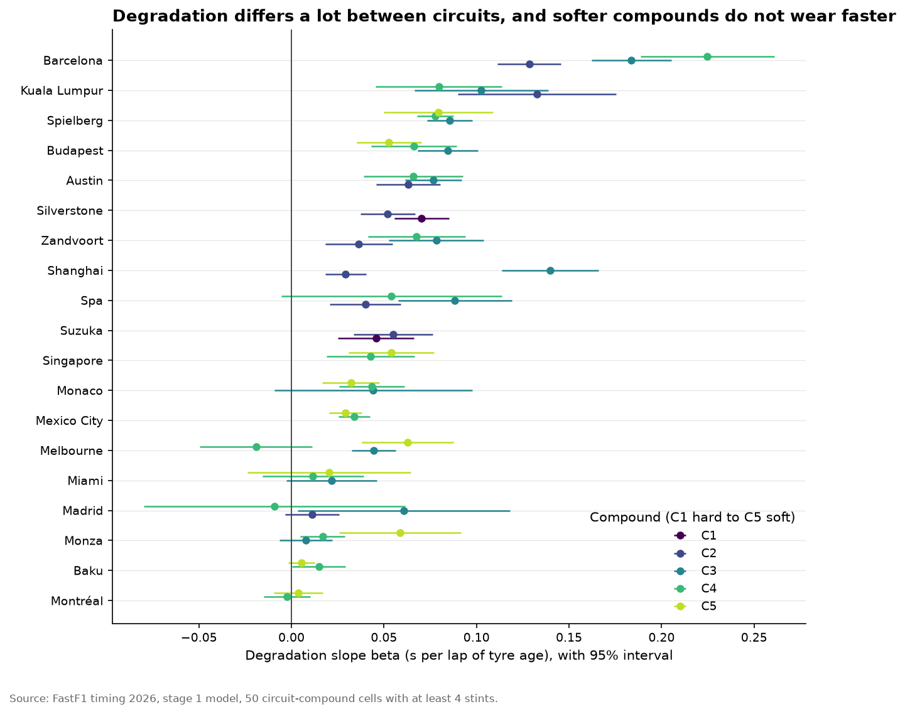

# Stage 2: do the hypotheses hold?

Reproduce: `python -m f1_pit_strategy.stage2` (this file is generated). Data: the 50 circuit-compound slopes from stage 1 that rest on at least 4 stints, from 19 circuits.

**Method.** Every test is an ordinary weighted least squares (WLS) regression of the stage-1 slopes, with weight 1 / SE² per cell, so a slope estimated more precisely counts more. The weights range 97-fold, the five most precise cells carry
35% of the total weight and the effective sample is 24 of 50 cells, so a handful of precise cells drive every result. Standard WLS also estimates a scale (the residual variance after weighting): 1 would mean the stage-1 standard errors explain the
scatter fully; ours are 3.3 to 16.6, so the cells scatter more than their standard errors imply, and the standard errors and the F-test below are widened to match.

## Result

| Hypothesis | Result | Verdict |
|---|---|---|
| H1: a softer compound wears faster (beta rises with softness inside a circuit) | +0.0038 s/lap per compound step (SE 0.0046, 95% interval -0.006 to +0.013, two-sided p = 0.42); the softer compound of a pair wears more in 21 of 43 within-circuit pairs | Not supported |
| H2: beta differs between circuits for the same compound | Joint F-test of the circuit terms: F = 11.06 on 18 and 27 degrees of freedom, p = 3e-08; weighted R² rises from 0.21 (compound only) to 0.91 (compound + circuit) | Supported |
| H3: wear rises with track temperature (compound controlled) | +0.0008 s/lap per °C (SE 0.0007 clustered by circuit, 95% interval -0.0006 to +0.0022, p = 0.25) across 19 circuits; plain WLS gives p = 0.10 | Not supported |

Beyond the three hypotheses: 47 of 50 slopes are positive and 38 have a 95% interval entirely above zero, so tyres do wear in most circuit-compound cells.

## What it means

### H2 holds, and it is the one the project needs
**How it was tested.** Two WLS models are compared. The restricted one explains each slope by its compound alone (`Beta ~ Compound`, 45 residual degrees of freedom, weighted squared error 748.9). The full one adds one intercept per circuit
(`Beta ~ Compound + Circuit`, 27 residual degrees of freedom, weighted squared error 89.4). The F statistic is the improvement per added circuit parameter divided by the leftover scatter per degree of freedom:
((748.9 - 89.4) / 18) / (89.4 / 27) = 11.06, with p = 3e-08. In plain words: compound alone explains 21% of the weighted variation in slopes, and knowing the circuit raises that to 91%.
Example, C3: Barcelona 0.184 (plus or minus 0.011) against Monza 0.008 (plus or minus 0.007).

**What it does and does not show.** It is evidence, not proof. The test asks whether differences *between* circuits are large compared with the scatter left *inside* circuits (scale 3.3 in the full model), which is a demanding comparison, and it still rejects clearly.
It tests "circuits differ given compound"; a circuit x compound interaction cannot be tested separately because each circuit-compound pair has one slope. It says circuits differ, not why.
**Consequence.** If we had assumed every circuit wears alike (one rate of about 0.05 s/lap), the rule would call Barcelona and Budapest one-stops, while 89% to 100% of their finishers made two or more stops.

### H1 does not hold, and it is an open problem
**How the test was done.** Inside each circuit we compare the wear slopes of the compounds it ran. A WLS regression gives each circuit its own intercept (so circuit differences drop out) and one coefficient for "one step softer" (`Beta ~ Circuit + Softness`).
If softer tyres wear faster, that coefficient must be positive. It is +0.0038 s/lap per step (95% interval -0.006 to +0.013): the data rule out a large effect but not a small one. A version with heteroscedasticity-robust errors agrees (p = 0.53).

Circuit by circuit, the slope rises with softness in 6 circuits, falls in 6 and is mixed in 7:

| Circuit | Slope by compound, hardest to softest | With softness |
|---|---|---|
| Melbourne | C3 +0.044  C4 -0.019  C5 +0.063 | mixed |
| Shanghai | C2 +0.029  C3 +0.140 | rises |
| Suzuka | C1 +0.046  C2 +0.055 | rises |
| Miami | C3 +0.022  C4 +0.012  C5 +0.020 | mixed |
| Montréal | C4 -0.002  C5 +0.004 | rises |
| Monaco | C3 +0.044  C4 +0.043  C5 +0.032 | falls |
| Barcelona | C2 +0.128  C3 +0.184  C4 +0.225 | rises |
| Spielberg | C3 +0.086  C4 +0.078  C5 +0.079 | mixed |
| Silverstone | C1 +0.070  C2 +0.052 | falls |
| Spa | C2 +0.040  C3 +0.088  C4 +0.054 | mixed |
| Budapest | C3 +0.085  C4 +0.066  C5 +0.053 | falls |
| Zandvoort | C2 +0.036  C3 +0.078  C4 +0.068 | mixed |
| Monza | C3 +0.008  C4 +0.017  C5 +0.059 | rises |
| Madrid | C2 +0.011  C3 +0.061  C4 -0.009 | mixed |
| Baku | C4 +0.015  C5 +0.006 | falls |
| Kuala Lumpur | C2 +0.133  C3 +0.103  C4 +0.080 | falls |
| Singapore | C4 +0.043  C5 +0.054 | rises |
| Austin | C2 +0.063  C3 +0.077  C4 +0.066 | mixed |
| Mexico City | C4 +0.034  C5 +0.029 | falls |

A second sanity check, pace: on a fresh tyre (age 5) the softest compound is faster than the hardest in 14 of 19 circuits, but only by a median 0.11 s;
at tyre age 15 it is faster in 10 of 19. Softer compounds are normally clearly faster when new, so this is a second mild warning.

**Why it matters.** That softer tyres wear faster is what we know from tyre design and from racing; your scope uses it as a sanity check on the data and the model (section 4). When a check that should pass fails, either the world is surprising or the measurement is off,
and the second is far more likely here. Consequences for the objective:
- The wear rate d might be biased by an amount and in a direction we cannot yet tell. The calls with a wide margin (for example Barcelona, Spielberg, Budapest) are less exposed; the four uncertain calls (Monaco, Zandvoort, Kuala Lumpur, Austin) are the most exposed.
- We cannot say which compound to run in which stint. The rule gives one stop count per circuit, not a compound plan.
- What still supports the calls: the circuit differences are real (H2) and the calls match real stop counts at 10 of 13 circuits (`docs/validation.md`).

**Possible causes (not yet tested).** A straight-line race-lap effect shared by all compounds may be wrong: soft and hard stints are run at different points of the race, so a misfit in how the car speeds up over a race lands on the compound terms.
Drivers may manage soft tyres, which flattens their slope. Wear may not be linear (curvature is still to be tested, scope section 8). Next checks: a flexible race-lap effect, a quadratic tyre-age term, and same-driver comparisons inside one race.

### H3 is not supported, and this test cannot settle it
The result is +0.0008 s/lap per degree (95% interval -0.0006 to +0.0022, errors clustered by circuit). Across the 36 degrees between the coolest and hottest circuit that is anything from -0.02 to +0.08 s/lap,
against typical wear of 0.05: the data are uninformative, not evidence that temperature does nothing. Plain WLS gives a smaller p-value (0.10) but it treats the 50 cells as 50 independent temperature readings, when cells of one circuit share one temperature
(only 19 distinct values), so its standard error (0.0005) is too small; the clustered version (0.0007) is the one to read. Reasons it is hard to see:
- With one race per circuit we compare circuits, and circuits also differ in surface, layout and tyre energy, which swamp temperature with only 19 of them.
- Temperature inside a race moves together with race lap (the track warms or cools as the race goes on), so it cannot be separated within a circuit.
- A circuit's average temperature is coarse, and tyres have an optimal window, so the link need not be a straight line.

**Consequence.** The rule measures each circuit's d directly, so it needs no temperature formula. What it cannot do is predict a hotter or colder race than the one in the data.

## H1 under other tyre-age windows

| Laps used | Cells | Softness effect (s/lap per C-step) | 95% interval | Two-sided p |
|---|---|---|---|---|
| all laps | 50 | +0.0038 | -0.006 to +0.013 | 0.42 |
| tyre age 6 or more | 50 | +0.0020 | -0.007 to +0.011 | 0.65 |
| tyre age 11 or more | 49 | -0.0008 | -0.009 to +0.008 | 0.86 |
| tyre age 20 or less | 50 | +0.0065 | -0.004 to +0.017 | 0.23 |

## Limits

- Stage 2 works on estimates, not on laps: stage-1 error reaches it only through the weights, and 50 cells over 19 circuits give limited power, especially for H3 and for C1 (2 cells).
- A few precise cells carry much of the weight (see Method); tests are in-sample and the stage-1 standard errors are approximate, so p-values are guides, not exact.
- Nothing here changes the Tier 1 and Tier 2 calls: d comes from stage 1.
